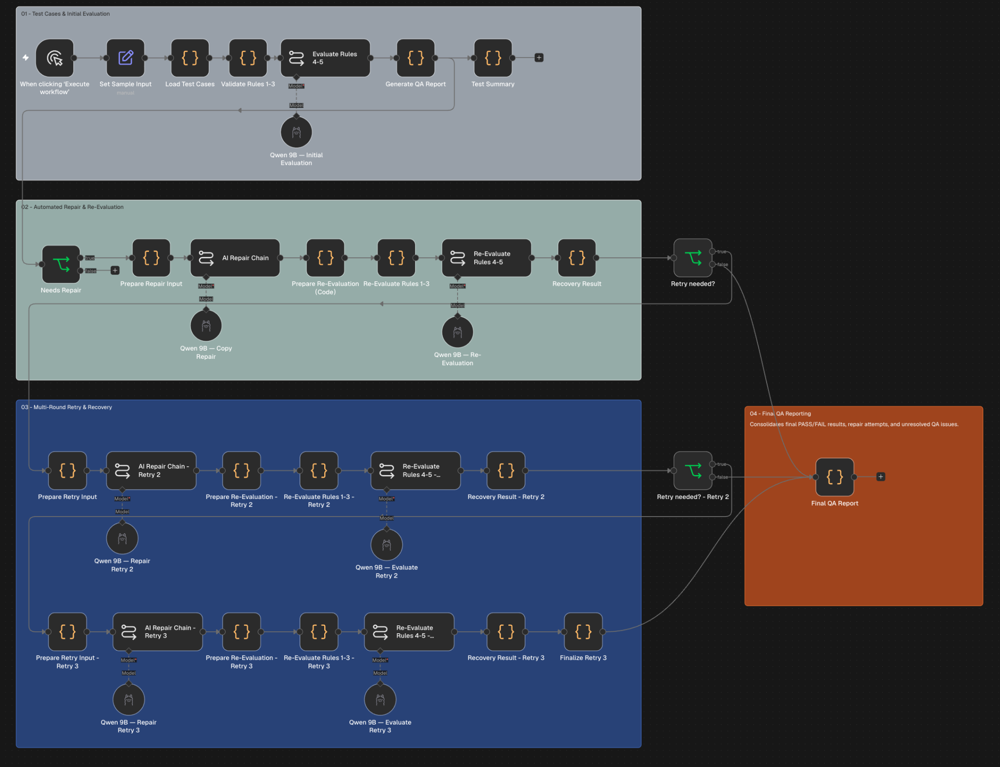

# AI Agent Evaluation & Recovery Harness

**Automated AI Quality Assurance with n8n, Ollama, Qwen, and JavaScript**

A local AI evaluation workflow that combines rule-based validation, LLM-powered quality assessment, automated content repair, and structured QA reporting.

This project demonstrates how AI-generated content can be systematically tested, evaluated, and improved through a controlled recovery process.

## 1. Project Overview

AI-generated content can contain structural errors, missing information, misleading claims, and unsupported promises.

This project explores how to detect these issues and automatically attempt corrections while maintaining clear evaluation criteria.

The workflow uses a hybrid approach:

- **JavaScript** for deterministic validation.
- **Qwen via Ollama** for semantic and factual-claim evaluation.
- **n8n** for workflow orchestration and conditional routing.
- **Automated retry logic** for content repair and re-evaluation.
- **Structured JSON reports** for test results and failure analysis.

The entire workflow runs locally without requiring paid cloud LLM APIs.

## 2. Workflow Architecture

The workflow consists of four main stages.

### Stage 1 — Test Cases & Initial Evaluation

Three predefined advertising-copy test cases are loaded and evaluated against five quality rules.

Java
